# WISDOM Intelligent Portfolio Manager

**Assessment write-up, Gaurav Kumar**

The universe is four stocks: Amber Enterprises, Dilip Buildcon (DBL), Welspun Living and Zee Entertainment.
The trade analysis is as of 14 Jan 2026. The backtest and today's recommendation use prices up to 23 Nov 2026.

> Each finding ends with a figure link, for example *[→ Figure 1](figures/01_performance.png)*. Click it to open the chart. All figures are collected at the end.

---

## The short version

1. **WISDOM wins by picking the right businesses, not by trading well.** The four stocks earned ₹88 crore on ₹69 crore invested, a 27.5% annual return. The same cash in the Nifty 50 on the same dates would have earned about 15% a year less. One stock, Amber, produced 84% of the profit. *[→ Figure 1](figures/01_performance.png)*
2. **The investor is disciplined about losses but impatient with winners.** Losing positions are cut quickly. But the best stock was sold too early, money tends to go into stocks that have just fallen, and the portfolio is very concentrated. *[→ Figure 8](figures/08_scorecard.png)*
3. **WISDOM's own principles point the right way.** The big winner (Amber) fits the principles best. The one loser (Zee) is exactly what the "what we avoid" list warns against.
4. **I built a rules-first portfolio manager with a carefully contained AI layer.**
   - Plain code calculates every number and makes every suggestion.
   - AI reads the broker research and explains each decision in plain English, and the code checks everything it says.
   - A person approves every decision.
5. **The most useful finding for WISDOM is a gap in the principles.** They say WISDOM will "pay premium valuations" for structural growth, but never say how much. That one number decides whether a rules-based system would have bought Amber at all, and it matters more than any other setting. *[→ Figure 11](figures/11_exit_multiple_sweep.png)*

---

## Part 1: What the trade history says about the investor

### Preparing the data

- **One table from four tabs.** The workbook has one tab per stock, with buys and sells matched FIFO (first in, first out). I turned it into one clean table of 1,177 lots and 510 actual trades.
- **Checked against the sheet.** Every block adds up to the sheet's own subtotals, to the rupee.
- **Real decisions separated from other events.** I compared every trade with that day's market price range. About a quarter of the money bought came from events other than a normal market purchase:
  - shares allotted before Amber and DBL listed;
  - a discounted share placement at DBL;
  - two buyback offers at Welspun;
  - transfers booked at old cost.

  These count towards profit, but not when judging timing, because the investor didn't choose that day's price.
- **Two details.** The data runs to December 2025, slightly beyond the period in the notes. Dividends aren't in the file, so returns are slightly understated.

### How the money was made

| Stock | Invested (₹ cr) | Profit (₹ cr) | Annual return | Return vs Nifty 50, per year |
|---|---|---|---|---|
| Amber | 24.8 | +73.9 | 33.9% | +21.3% |
| DBL | 36.3 | +12.5 | 14.7% | +1.8% |
| Welspun | 4.0 | +2.6 | 17.2% | +3.0% |
| Zee | 3.6 | −0.9 | −21.1% | −29.1% |
| **Total** | **68.7** | **+88.1** | **27.5%** | **+14.6%** |

- **Annual return** is an XIRR: it accounts for the timing of every rupee in and out.
- **Return vs Nifty 50** compares the same cash flows with buying the index on the same dates.

**The result comes from one great stock.** Without Amber, the other three together earned roughly what the index did. *[→ Figure 1](figures/01_performance.png)*

The portfolio was very concentrated. On average it behaved like a portfolio of fewer than two equal-sized stocks, and at its peak Amber was 80% of it. *[→ Figure 3](figures/03_exposure.png)*

### Timing: when did buying and selling help?

For each trade I looked at the stock's next 12 months and compared them with an average 12 months for that stock. A buy is good if the stock then did better than usual; a sell is good if it then did worse.

- **Amber:** good buys (+15 points better than average), but **sold too early**, because the stock kept rising after the sells (−23 points).
- **DBL and Welspun:** the reverse. Weak buys (−13 and −15 points), but **very well-timed sells** (+40 and +37 points).
- **Zee:** small effects. The issue with Zee was choosing it, not timing it.

*[→ Figure 5](figures/05_timing.png)*

The investor **likes to buy after a fall**. About 70% of all money invested went in when the stock was lower than six months earlier. That worked very well in Amber, which was bought near its lows, but less well in the weaker businesses, where the falls often continued. *[→ Figure 6](figures/06_entries.png)*

Every trade is shown on the price chart: filled triangles for buys, open triangles for sells. *[→ Figure 2](figures/02_trades_on_price.png)*

### Holding, sizing and discipline

- **Holding period.** WISDOM invests for 1–20 years. Amber was held that way: 65% of its money stayed at least 2 years. For the other three it was 19–37%, and a third of all money in closed positions was held under a year. *[→ Figure 4](figures/04_holding.png)*
- **Cutting losses: a real strength.** Many investors hold losers and sell winners too quickly (the "disposition effect"). WISDOM does the opposite and sells losing positions about three times more readily than winning ones. Zee is the exception: there, losers were held longer than winners.
- **Bet size.** Bigger buys did not turn out better than smaller ones. Conviction shows in *which* stock is held more than in *how much* is bought each time. Most money was added at prices above the average cost. Buying more below cost ("averaging down") happened most often in Zee, the one losing stock. *[→ Figure 7](figures/07_sizing.png)*

### Scorecard

Seven habits, each scored from 0 to 10 with simple, visible rules. The rules can be changed in the notebook.

| Habit | Score | In plain words |
|---|---|---|
| Returns vs index | 9.8 | Clearly beat the market |
| Cutting losses | 10.0 | Losers are sold faster than winners |
| Holding period | 8.7 | Good overall, mostly because of Amber |
| Bet sizing | 4.7 | Bigger buys didn't do better |
| Buy timing | 3.6 | Buys after falls, which worked mainly in Amber |
| Sell timing | 1.8 | Sold the best stock too early |
| Spreading risk | 2.3 | Very concentrated |

*[→ Figure 8](figures/08_scorecard.png)*

**What this means for the system:** keep the strengths (stock selection, cutting losses) and add guardrails for the weaknesses (selling compounders early, buying falling stocks, over-concentration).

---

## Part 2: The portfolio manager

### How it works

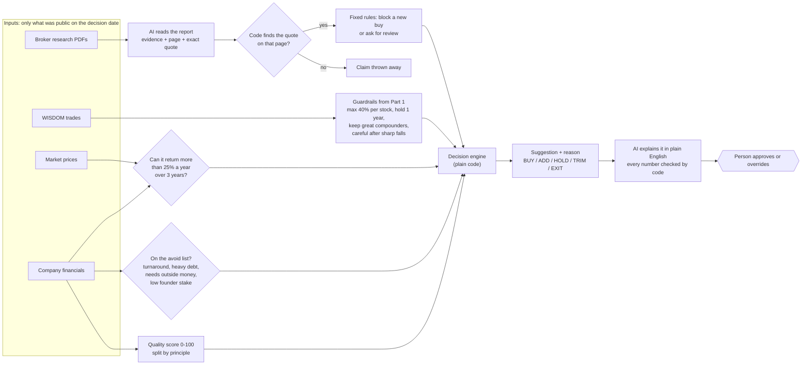

Every quarter, using **only information that was public at the time**, the system goes through six steps for each stock:

1. **Quality score (0–100)**, split by WISDOM's principles: growth, return on capital, steadiness through bad years, cash generation, debt, and how much the founders own.
2. **The "what we avoid" checks:** turnarounds, heavy debt, businesses that keep needing outside money, and companies where the founders own little.
3. **The 25% test:** can the stock reasonably return more than 25% a year over three years, given its earnings power and a fair end valuation for a business of its quality?
4. **Guardrails from Part 1:**
   - no stock above 40% of the portfolio;
   - hold at least a year;
   - don't sell a high-quality business just because it looks expensive;
   - extra care when buying after a sharp fall;
   - build positions gradually.
5. **A suggestion** (buy, add, hold, trim or exit) with a written reason.
6. **A plain-English explanation** of the suggestion, which a person then approves or overrides.

### The AI layer: useful, but checked

The AI does two jobs. Neither involves calculating numbers or making decisions.

**Reading research.**
- The AI reads each broker report and pulls out evidence for every principle, plus warning signs.
- Every point must come with a page number and an exact quote. The code then looks for that quote on that page and throws away anything it can't find.
- Across the four reports, 87 of 88 points passed. The one dropped was a "quote" of a single word.
- A verified serious warning can only **block a new buy** or **ask for review**. It can never force a sale.

**Explaining decisions.**
- After the engine decides, the AI turns its decision record into a short explanation: why, what drove it, what would change it, and the strongest argument against it.
- Every number in the explanation must appear in the record, otherwise the explanation is rejected and a plain template is shown instead.
- The AI sees stock-level facts only, never WISDOM's holdings or position sizes.

### Assumptions

- Decisions are made once a quarter, after results season.
- Annual results are treated as public 60 days after the year ends.
- Trades happen at the next day's closing price.
- Trading costs 0.25% each way, and idle cash earns 6%. Dividends and tax are ignored on both sides.
- All limits come from the written principles and were set before testing. The valuation method was revised once, after the first test, for the reason given below. Nothing else was tuned.
- Financial data comes from Screener.in and prices from Yahoo Finance.
- The broker reports are all from May 2026, so the research layer informs today's decision. It is not part of the historical test.

### Testing on history (Jul 2018 to Nov 2026)

I tested two ways of valuing growth:
- **Method A** values a company on its average profit over the last three years.
- **Method B** looks at sales growth and normal profit margins. It is fairer to businesses that are still scaling up, which is what WISDOM's Principle 4 asks for.

| | Annual return | Worst fall |
|---|---|---|
| Method A | 6.9% | −28% |
| Method B (used going forward) | 7.5% | −28% |
| Nifty 50 | 10.9% | −38% |
| Holding all four stocks equally | 15.6% | −57% |

*[→ Figure 9](figures/09_ipm_vs_benchmarks.png)*

- **Against the index.** The system's worst fall was smaller than the index's, but it did not beat it.
- **Why.** It spent most of the period in cash, because few stocks passed every test at once, and it never bought Amber. *[→ Figure 10](figures/10_ipm_decisions.png)*

**Why it never bought Amber.** The rules allow a top-quality business an end valuation of up to 28 times earnings. Amber traded at 40–90 times earnings throughout. The investor still earned ₹74 crore on ₹25 crore there, because the earnings grew *and* the high valuation held.

**How much that one limit matters.** I re-ran the test across a range of limits and report all of them, not just the best:
- above about 35× the system starts buying Amber;
- annual returns range from 7.5% to 15.9%;
- the pattern is uneven: 9.5% at 35×, 7.5% at 40×, 10.3% at 50×.

With four stocks there is no single "right" number. The test shows that the logic works and how sensitive it is; it is not a claim of skill. *[→ Figure 11](figures/11_exit_multiple_sweep.png)*

**Recommendation to WISDOM:** write down how much you are willing to pay for a great, fast-growing business. It is the single most important setting in a rules-based version of your process.

### What it suggests for the current portfolio (23 Nov 2026)

| Stock | Share of portfolio | Suggestion | Main reason |
|---|---|---|---|
| Amber | 45% | Exit | Spent more than it earned over 3 years and borrowed more to fund growth (an "avoid" rule) |
| DBL | 43% | Hold | Quality is weak, but it was bought less than a year ago, so the minimum hold applies |
| Welspun | 11% | Trim to 6% | Little upside at today's price. Research also blocks new buying: the broker's BUY case needs profits to rebound 80% after falling 39%, which is a turnaround |
| Zee | 1% | Exit | Turnaround, and the founders own only 4% |

Every line goes to a person for review. **The Amber call shows why.** One principle says avoid businesses that depend on outside money; another says back businesses that reinvest for growth. Amber's borrowing funds a factory expansion. The system's job is to show this conflict clearly so a person can decide, and its explanation for Amber does exactly that.

---

## Part 3: Running this for real

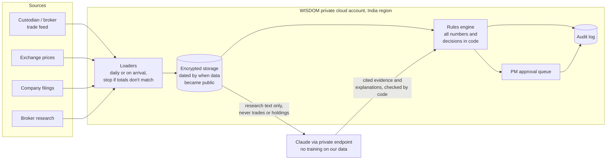

The key boundary: WISDOM's trades and holdings never leave the private account. The AI only sees research text and stock-level facts.

### Data pipelines

| Data | How it comes in | How often | How it's stored |
|---|---|---|---|
| Trades | Custodian/broker feed; totals checked before loading | Daily | Clean trade tables, each trade tagged as a market trade or not |
| Prices | Exchange or data-vendor feed | Daily | Prices plus splits, bonuses and dividends |
| Financials | Company filings | When results come out | Stored by the date they became public, so a test can never "see the future" |
| Research | PDF → text by page → AI extraction → quote check | When a report arrives | Each point saved with its page, quote and model version |

Loads can be re-run safely, a failed check stops the load, and every suggestion records which data it used.

### Keeping the data safe

- **WISDOM's trades and holdings never go to an AI model.**
- Data is encrypted at rest and in transit. Research and positions have separate access.
- The AI runs through an enterprise service that doesn't train on our data, over a private connection, with every request logged.
- **In this prototype:**
  - the Excel password sits in a local file that is never uploaded;
  - no WISDOM data is in the repository;
  - all downloaded files will be deleted after the review.

### Using AI safely

- **AI is used for:** reading long reports, finding evidence, and explaining each decision in plain English. Later: summarising earnings calls and drafting review notes.
- **AI is not used for:** any number, valuation, buy/sell decision or position size. These stay in plain code so anyone can check and repeat them.
- **Guarding against made-up answers:**
  - a fixed answer format;
  - a quote and page for every claim, checked by code;
  - a number check on every explanation;
  - permission to say "not covered" instead of guessing;
  - saved answers, so the same input always gives the same output.
- **The remaining risk:** how serious a warning is rated is still the AI's judgment. That's why every block goes to a person, and why a sample should be spot-checked regularly.

### Agents and human control

Today this is a fixed, step-by-step pipeline, not a free-running agent. Agents could later fetch new filings and re-check holdings when results come out. Any agent would follow the same rules:
- read-only access to data;
- no access to order systems;
- a fixed list of tools and a step limit;
- outputs checked the same way.

Nothing becomes a trade without a named person approving it. Overrides are recorded with a reason, which over time shows where the rules and human judgment differ.

### Cloud

I'd use a single private cloud account in an Indian region, running scheduled jobs rather than always-on servers. Two services anchor it:
- **Amazon Bedrock (Claude):** no training on customer data, private connectivity, access logging.
- **Amazon S3** for storage: encrypted, versioned, and queried with Athena or a small Postgres database.

If ENAM is mainly a Microsoft shop, the same design works on Azure. In both cases, regional availability of the AI models should be confirmed.

---

## Next steps

Two improvements to the portfolio manager itself. Both are justified by the principles' own wording, and I would fix them in advance and test them once:

- **Own the market when nothing qualifies.** Today, idle money sits in cash. If no stock passes the tests, holding the index instead fits "we only buy great businesses" without paying for the cash drag. This is likely the biggest reason the system trailed the index.
- **Separate borrowing to grow from borrowing to survive.** The "needs outside money" rule currently treats a company borrowing to build capacity (Amber) the same as one borrowing to stay afloat. A fairer rule would allow debt-funded growth while the new investment earns a good return, which is what Principle 3 ("businesses that can reinvest at attractive rates") asks for.

More broadly:

- **Widen the test** to more stocks and to archived research, so the AI layer can be tested on past decisions too.
- **Confirm the special events** (pre-IPO allotments, placement, buybacks) against exchange filings.
- **Add dividends and tax** to both the investor's returns and the backtest.
- **Agree with WISDOM a clear rule on premium valuations** for high-quality growth businesses.

---

## Figures

**Figure 1: Where the profit came from, and each stock against the Nifty 50.** Amber is 84% of total profit; Zee is the only stock that lagged the index.
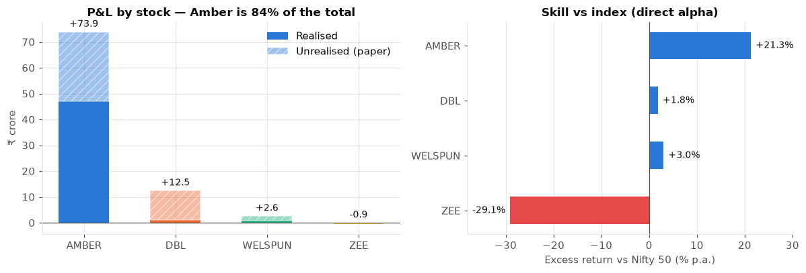

**Figure 2: Every market trade on the price chart.** Filled triangles are buys, open triangles are sells, and bigger triangles mean more money. Grey marks are allotments, buybacks and transfers.
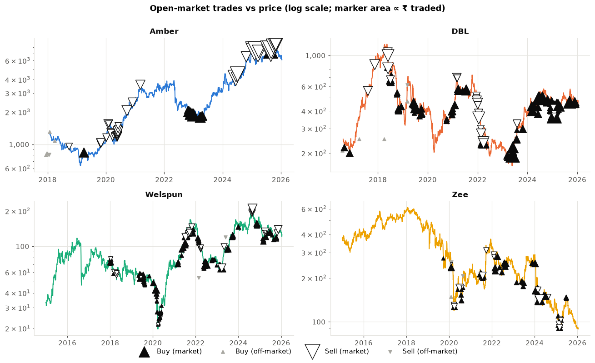

**Figure 3: Portfolio value by stock over time.** Amber and DBL dominate throughout.
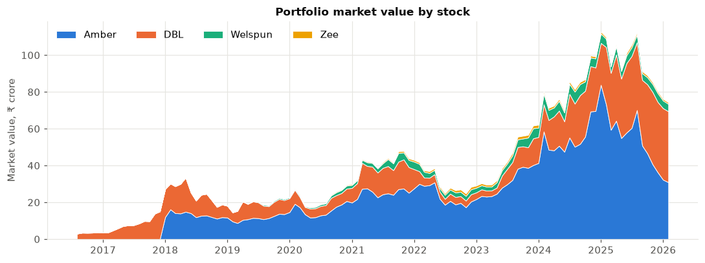

**Figure 4: How long money stayed invested.** Amber was held for the long term; DBL and Zee money mostly left within two years.
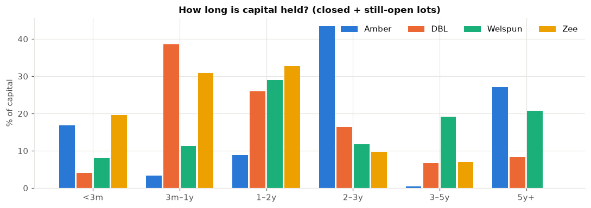

**Figure 5: Did buying and selling help?** Blue means the timing helped, red means it hurt. Amber buys helped but its sells hurt, and the reverse holds for DBL and Welspun.
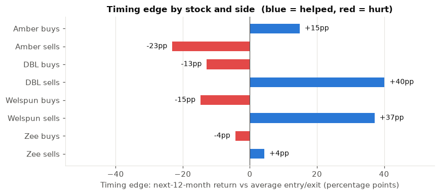

**Figure 6: What happened after each buy, and what the stock had done before it.** Most money went in after a stock had fallen.
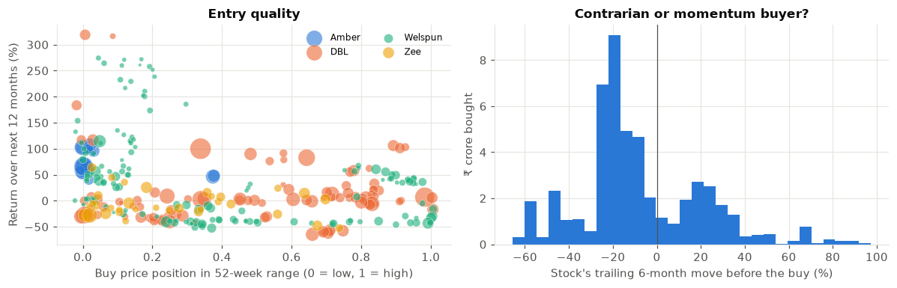

**Figure 7: How money was added: above the average cost (blue) or below it (red).** Most money was added above cost; averaging down was most frequent in Zee.
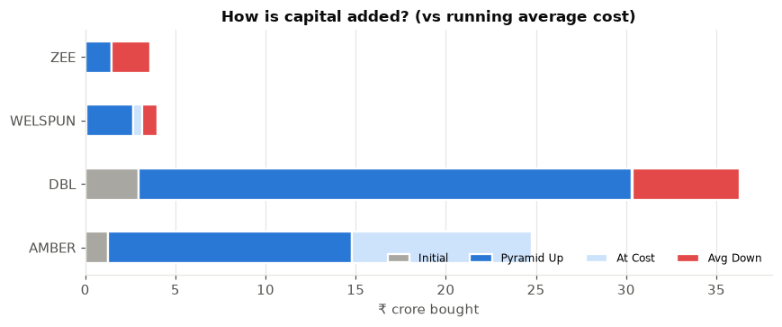

**Figure 8: Investor scorecard.** Strong on returns and cutting losses, weaker on sell timing and spreading risk.
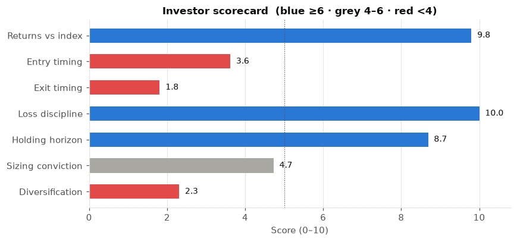

**Figure 9: The system against Nifty 50 and a simple equal-weight portfolio.** Smaller falls than the index, lower return. In the chart, "IPM v1" is Method A and "IPM v2" is Method B.
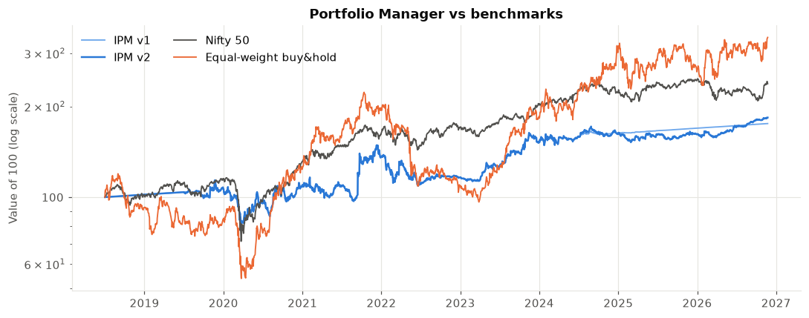

**Figure 10: What the system decided each quarter (top: Method A, bottom: Method B).** Mostly in cash; it never bought Amber or DBL at the standard valuation limits.
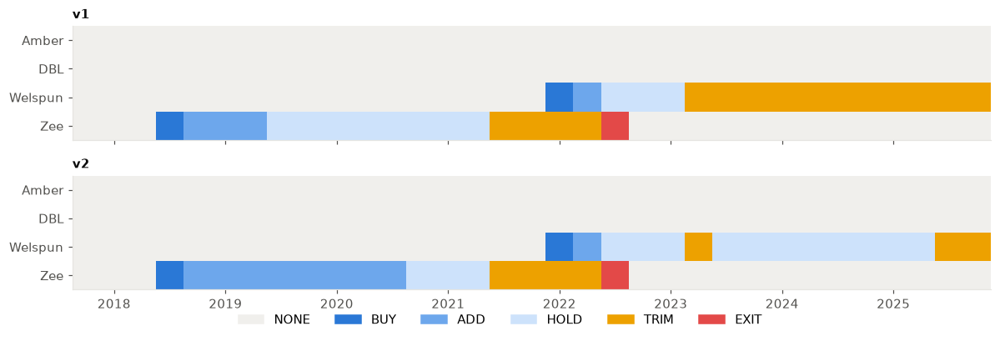

**Figure 11: How the result changes with the valuation limit.** The pattern is uneven, so with four stocks there is no single "right" setting.
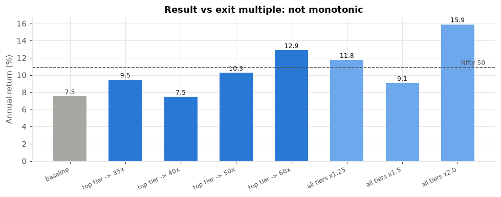
